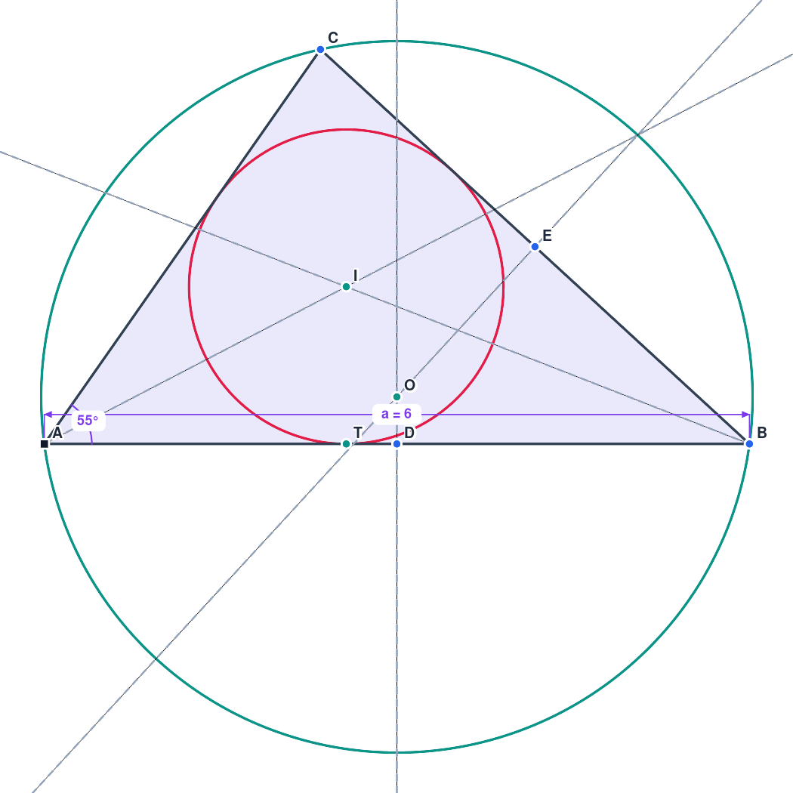
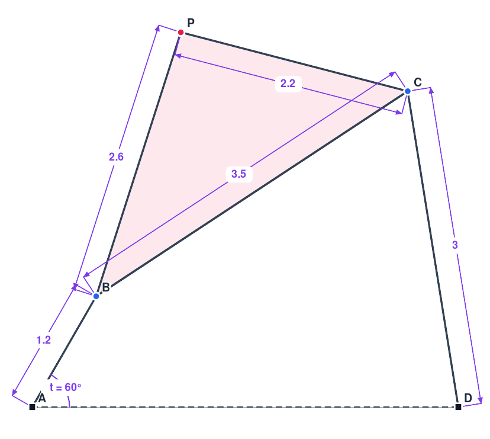

# DrawMath: an open-source Claude Code skill for geometry diagrams

**DrawMath** is a free, open-source [Claude Code](https://claude.com/claude-code) skill
(`drawmath`) together with the constraint-based geometry app it drives. Ask Claude for a
diagram in plain English, for example *"draw a triangle with its circumcircle and incircle, and
give me a slider for the base"*, and it builds the figure live in your browser. You can then
drag it, animate it and keep editing, by hand or by asking Claude.

<p align="center">
  
  
</p>

The app also works on its own, without Claude: it's a lightweight, GeoGebra-style sketcher with a
real constraint solver.

## Features

- **Drawing tools:** point, segment, line, ray, polygon, rectangle, regular polygon, circle
  (center + point / 3 points), arc.
- **Constructions:** midpoint, intersections, perpendicular / parallel lines, perpendicular
  bisector, angle bisector, tangents from a point, reflection.
- **Constraints:** coincident, point-on-object, midpoint, fix, horizontal, vertical, parallel,
  perpendicular, equal length/radius, tangent, symmetric. Dragging keeps every constraint
  satisfied, conflicts are refused, and the status bar shows the remaining degrees of freedom.
- **Driving dimensions:** lengths, distances, angles and radii that accept numbers *or
  expressions* (`2*a+1`, `sqrt(a^2+b^2)`, `t/2`).
- **Slider variables:** any value can be tied to a slider, and sliders animate (bounce / loop /
  once). Turn on *Trace* for a point to draw its locus, which makes linkages and mechanisms easy.
- **Also:** hide/show, undo/redo, save/open JSON, SVG and PNG export, autosave.
- **Live sync:** the app and a scene file on disk stay in sync, so changes Claude makes appear
  instantly and changes you make are visible to Claude.
- **Headless CLI:** builds drawings from short scene scripts, using the same solver as the app.

## Install the skill

Requirements: [Claude Code](https://claude.com/claude-code) and **Node.js 18+**. For PNG
previews, optionally install `rsvg-convert` (librsvg) or ImageMagick. There are no npm
dependencies.

Clone the repository into your Claude Code skills folder:

```bash
git clone https://github.com/haroonalisa/drawmath.git ~/.claude/skills/drawmath
```

Then **restart Claude Code** (or start a new session) so it picks up the skill. Check that it is
listed by asking Claude *"what skills do you have?"*

- **Only for one project?** Clone it into that project instead:
  `git clone https://github.com/haroonalisa/drawmath.git .claude/skills/drawmath`
- **Update:** `git -C ~/.claude/skills/drawmath pull`
- **Uninstall:** `rm -rf ~/.claude/skills/drawmath`

## Use it

Just ask Claude in any session:

> Draw a slider-crank mechanism and trace the midpoint of the connecting rod.
>
> Make a right triangle with legs a and b, show the altitude to the hypotenuse, and label all angles.
>
> In my current drawing, add the incircle and make AB always horizontal.

On first use Claude starts the local server and opens **http://localhost:8765** (the Claude
desktop app's browser pane, or your default browser). After that the open tab updates live
whenever Claude changes the diagram. Your own edits (dragging, sliders, new shapes) are saved
back, so you can keep refining together. Ask for an **SVG/PNG** when you want a file for a
document.

## Use the app on its own

```bash
cd ~/.claude/skills/drawmath   # or wherever you cloned it
npm start                               # same as: node server.mjs  →  http://localhost:8765
```

You can also open `index.html` directly in a browser; it works fully offline, just without live
file sync. Press **?** in the app for every tool and shortcut.

| | |
|---|---|
| Tools | Left toolbar. Keys: `V` move, `P` point, `S` segment, `L` line, `C` circle, `D` dimension, … |
| Constraints | Select objects, then click a button in the bar on top |
| Values | Double-click a dimension and type `3.5`, `a`, `2*a+1` … (new names become sliders) |
| Navigate | Wheel zoom · right-drag / Space-drag pan · `Home` fit |
| Hide | `H` hide selection · `Shift+H` show all · *Show hidden* to pick hidden items |

## The CLI and scene scripts

Claude uses this, and you can too:

```bash
node cli/drawmath.mjs build examples/triangle-centers.scene.js --png preview.png   # build + solve + write scenes/current.json
node cli/drawmath.mjs build more.scene.js --append                                  # add to the current drawing
node cli/drawmath.mjs info                                                          # summary of the current drawing
node cli/drawmath.mjs svg --out figure.svg                                          # export
```

A scene script is plain JavaScript using a small API:

```js
slider('a', 6, 2, 10);
const A = point(0, 0, { name: 'A', fixed: true }), B = point(6, 0, { name: 'B' }), C = point(2, 3.5, { name: 'C' });
const t = polygon(A, B, C);
horizontal(t.edges[0]);
length(t.edges[0], 'a');          // base length follows slider a
angleAt(B, A, C, 55);             // 55° at A
const [O] = intersect(perpBisector(t.edges[0]), perpBisector(t.edges[1]), { names: ['O'] });
circle(O, A);                     // circumcircle
```

The full API reference is in [SKILL.md](SKILL.md), and there are more scripts in
[`examples/`](examples).

## How it works

- `js/`: the app. It's plain browser scripts with no build step: an expression parser, the
  document model, a **damped minimum-norm Newton solver** (unconstrained things stay put while
  you drag), rendering, tools, panels, and live sync.
- `server.mjs`: a dependency-free Node server. It serves the app and syncs `scenes/current.json`
  with open tabs over server-sent events.
- `cli/`: `drawmath.mjs` loads the same `js/` engine in a Node VM and runs scene scripts
  (`api.js`). What the CLI builds is exactly what the app would build.
- `SKILL.md`: the instructions Claude follows: start and open the app, write a scene script,
  build, check the solver report and a PNG preview, then iterate.
- `scenes/`: your drawings and Claude's scene scripts. This folder is git-ignored, and replaced
  drawings are backed up to `scenes/.history/`.

## Contributing

[Issues](https://github.com/haroonalisa/drawmath/issues) and pull requests are welcome: new tools, constraint types, scene-API helpers, and
better rendering or export. There's no build step, so edit the files and reload. If you change
the scene API in `cli/api.js`, please update the reference in `SKILL.md` too.

## Author

Created by **Haroon Al Isa** ([@haroonalisa](https://github.com/haroonalisa)).

## License

[MIT](LICENSE) © Haroon Al Isa. Free to use, modify and share.
